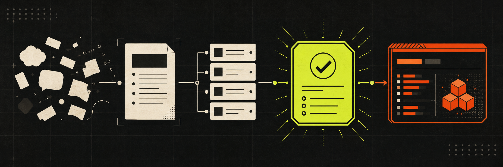
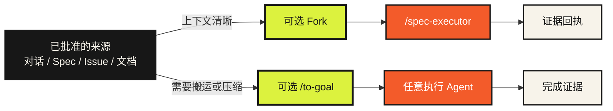

<p align="center">
  
</p>

<div align="center">

# Matt Skills with To-Goal

**把任务边界写清楚，其余交给模型：能继承就 Fork，要搬运就 Goal**

一组可以独立安装、按需组合的 Agent Skill。它们稳定任务合同、权限和证据，不规定模型必须用哪套思考或工程流程。

[](https://github.com/mattpocock/skills)
[](https://github.com/tt-a1i/matt-skills-with-to-goal)
[](#安装)
[](LICENSE)

`any approved source → optional goal or fork → evidence returns`

[**▶ 在线故事版：别让一个线程从需求聊到代码写完**](https://verifiable-goal-weekly-share-public.pages.dev)

</div>

## 它解决什么问题

AI coding 任务常常从需求讨论一路聊到代码实现。线程越长，上下文越容易膨胀、压缩和变慢；但直接开新线程，又担心缺少需求背景和已经确认的决策。

这套技能提供几个松耦合边界。它们可以组合，但没有固定流水线：

| 常见困境 | 这套流程的处理方式 |
|---|---|
| 方案讨论和代码实现挤在一个长线程里 | 从任何已批准的需求来源 fork，执行线程承担代码和验证日志 |
| Fork 后又重新分析和改写一遍 Goal | `spec-executor` 直接执行继承的合同，并回传结构化 receipt |
| Fork、启动和回传仍要手工串起来 | `execute-spec-in-fork` 自动创建执行任务、发送 Ask、接回结果并条件归档 |
| 当前上下文太脏、无法可靠继承 | `to-goal` 把对话、文档、issue 或仓库证据压成干净的执行契约 |
| “做完了”依赖人的主观判断 | Goal 带完成标准，executor 回传逐项证据和外部操作状态 |

> **Fork 负责隔离后续上下文，Goal 负责压缩已有上下文。** 两者都是可选能力，不要求固定的规划、实现或评审流程。

## 30 秒看懂组合方式



来源只要已经明确范围、完成标准和权限即可，不需要带特定 Skill 的标记。模型可以自行选择规划、实现、测试和评审方法；已有专项 Skill 或工具时可以使用，没有时也不会阻塞。

## 三分钟开始

### 1. 安装

Claude Code 可以把本仓库作为独立 marketplace 安装：

```bash
claude plugin marketplace add tt-a1i/matt-skills-with-to-goal
claude plugin install matt-skills-with-to-goal@tt-a1i
```

Codex 和其他支持 Agent Skills 的工具使用 `skills.sh`：

```bash
npx skills@latest add tt-a1i/matt-skills-with-to-goal
```

两种方式选一种，避免同一个 Skill 被重复加载。本仓库维护者可运行 `npm run sync:local`，把工作树安全同步到统一的 `~/.agents_skills/` 并刷新 Hermes。

Codex App 中的自动 Fork 闭环还需要单独安装 [Codex Task Messenger](https://github.com/tt-a1i/codex-task-messenger)。其他 harness 仍可手动 Fork 后运行 `spec-executor`，不影响核心执行能力。

### 2. 选择需要的能力

整套安装提供本 fork 精简后的默认集合。更轻的方式是只安装需要的 Skill：

```bash
npx skills@latest add tt-a1i/matt-skills-with-to-goal --skill=to-goal
```

`to-goal`、`goal-crafter` 和 `spec-executor` 都可以独立工作。只有 `execute-spec-in-fork` 因为负责 Codex App 任务通信，明确依赖 `spec-executor` 和 Codex Task Messenger。

### 3. 直接使用

```text
# 把当前已确认的工作压成可搬运合同
/to-goal

# 或把当前已确认的工作放入 Codex Fork 执行
/execute-spec-in-fork
```

不需要先运行初始化、访谈、Spec 或 Tickets Skill。输入尚未明确时，模型先补齐真正缺失的决策；任务过大时，它会建议拆分，但不会强制路由到某个 Skill。

## Fork 与 `to-goal` 如何分工

- **`execute-spec-in-fork` + `spec-executor`**：当前线程已经把工作谈清楚，且能在一个执行会话完成；自动建立同目录执行任务和回传通道。
- **`to-goal`**：需要跨人、跨天、跨引擎、并行，或者当前历史过长、存在多版冲突；用压缩后的执行合同换取干净上下文。
- **同线程直接实现**：小而明确、不值得跨上下文的改动，让模型直接完成即可。

自动 Fork 闭环拆成三层，每一层都可以单独复用：

| 层 | 负责 | 不负责 |
|---|---|---|
| 编排 · [`execute-spec-in-fork`](./skills/engineering/execute-spec-in-fork/SKILL.md) | 创建、命名、启动执行任务，校验 receipt，条件归档 | 写代码；替用户授权 commit / push / 部署 |
| 执行 · [`spec-executor`](./skills/engineering/spec-executor/SKILL.md) | 锁定已批准来源，实现、验证、评审，输出带证据的 receipt | 创建 Fork；在任务之间传话 |
| 通信 · [Codex Task Messenger](https://github.com/tt-a1i/codex-task-messenger) | 把 Ask / Reply / Resume 送到这次创建的准确任务 | 批准任何外部动作；消息不等于授权 |

没有 Codex App 任务工具或 Messenger 时，手动 Fork 后仍可运行 `spec-executor`。Executor 不绑死 Codex；Goal 更是一份可粘贴到 Cursor、Claude Code 或其他引擎的合同。

## `to-goal` 增加了什么

`to-goal` 把任何已批准的工作来源进一步编译成“新线程可以直接执行的契约”。来源可以是对话、spec、issue、文档或已有代码状态，不要求来自 `to-tickets`。Goal 买的是可移植性：换会话、换人或换引擎之后，仍按同一份标准交付。

```text
Goal
├── Current state       分支、HEAD、已完成证据、已知缺口
├── Execution order     最短的依赖顺序
├── Completion criteria 可逐条判断 done / not done 的标准
├── Constraints         范围、权限、脏文件与外部操作边界
└── Context             spec、ticket、设计文档和验证入口
```

默认每个明确、未阻塞的工作单元一份 Goal，不强制先建 ticket。互不阻塞的切片可以分别交给不同 Agent，在独立 branch / worktree 里并行；`to-goal` 只生成合同，不创建这些执行环境。

两个写作入口各有侧重：

- **`goal-crafter`**：从想法起草 Goal，只澄清真正缺失的目标、范围和完成标准。
- **`to-goal`**：把已批准的来源和仓库现状编译成可搬运合同，不重新访谈。
- **`spec-executor`**：实际实现和验证。前两个入口都不执行任务，也不创建自动化。

## 可选入口

| 你的情况 | 从这里开始 |
|---|---|
| 只想直接完成一个清楚的小任务 | 不使用 Skill，直接交给模型 |
| 有一个想法，需要把需求问清楚 | `/grill-me` |
| 想边聊边沉淀文档 | `/grill-with-docs` |
| 工作很大，连路线都还不清楚 | `/wayfinder` |
| 决策已成形，想让对立视角围攻它 | `/roundtable` |
| 已有共识，需要形成 spec | `/to-spec` |
| 已有明确工作合同，要在 Codex Fork 中执行 | `/execute-spec-in-fork` |
| 已有 spec，需要拆成可执行切片 | `/to-tickets` |
| 已有 agent-ready ticket，要开新线程实现 | `/to-goal` |
| 关键在别人脑子里，需要问卷收集 | `/to-questionnaire` |
| 外部 issue / PR 需要评估和分流 | `/triage` |

## 技能地图

仓库保留 **23 个 promoted Skills** 作为可选目录，不代表推荐全部安装或按顺序使用。18 个来自上游；本 fork 新增 `to-goal`、`goal-crafter`、`spec-executor`、`execute-spec-in-fork`、`roundtable`。fork 自有的 Goal 与执行 Skill 除了明确声明的工具依赖外，都能独立使用；上游 Skill 保留各自原有风格。

### User-invoked

| Skill | 作用 |
|---|---|
| [`grill-with-docs`](./skills/engineering/grill-with-docs/SKILL.md) | 访谈时维护领域词汇表和 ADR |
| [`improve-codebase-architecture`](./skills/engineering/improve-codebase-architecture/SKILL.md) | 调查架构改进机会，由用户选择下一步 |
| [`retro`](./skills/engineering/retro/SKILL.md) | 复盘会话，改进 Agent 的环境和检查 |
| [`roundtable`](./skills/engineering/roundtable/SKILL.md) | 用多个对立视角检验已形成的决策 |
| [`setup-matt-pocock-skills`](./skills/engineering/setup-matt-pocock-skills/SKILL.md) | 配置需要 tracker 的技能所用的项目约定 |
| [`to-goal`](./skills/engineering/to-goal/SKILL.md) | 把已批准来源与仓库现状编译成执行合同 |
| [`to-spec`](./skills/engineering/to-spec/SKILL.md) | 把已达成共识的讨论整理成 Spec |
| [`to-tickets`](./skills/engineering/to-tickets/SKILL.md) | 拆成带依赖关系的工作切片 |
| [`triage`](./skills/engineering/triage/SKILL.md) | 评估和分流外部 Issue 或 PR |
| [`wayfinder`](./skills/engineering/wayfinder/SKILL.md) | 为超大任务建立调查与决策地图 |
| [`grill-me`](./skills/productivity/grill-me/SKILL.md) | 只通过讨论澄清想法，不要求保存文件 |
| [`handoff`](./skills/productivity/handoff/SKILL.md) | 生成可移交的会话上下文 |
| [`teach`](./skills/productivity/teach/SKILL.md) | 以工作目录保存多会话学习进展 |
| [`to-questionnaire`](./skills/productivity/to-questionnaire/SKILL.md) | 整理需要他人回答的问卷 |
| [`wait-what`](./skills/productivity/wait-what/SKILL.md) | 补充背景，用容易理解的方式重新解释 |

### Model-invoked

| Skill | 作用 |
|---|---|
| [`domain-modeling`](./skills/engineering/domain-modeling/SKILL.md) | 维护领域词汇和 ADR |
| [`execute-spec-in-fork`](./skills/engineering/execute-spec-in-fork/SKILL.md) | 创建执行 Fork，验证回传并处理生命周期 |
| [`goal-crafter`](./skills/engineering/goal-crafter/SKILL.md) | 从想法起草 Goal，只补齐缺失的决策 |
| [`pr`](./skills/engineering/pr/SKILL.md) | 用图示、证据和风险说明 PR |
| [`spec-executor`](./skills/engineering/spec-executor/SKILL.md) | 执行已批准工作并回传证据 |
| [`wizard`](./skills/engineering/wizard/SKILL.md) | 生成必须由人参与的交互式操作向导 |
| [`grilling`](./skills/productivity/grilling/SKILL.md) | 按决策依赖分轮提问 |
| [`writing-for-agents`](./skills/productivity/writing-for-agents/SKILL.md) | 编写 Agent 使用的技能、引导与参考文档 |

## 设计边界

- 默认一个 goal 覆盖一个明确、未阻塞的工作单元；`--all` 仅用于明确要求的跨 ticket 持久化执行。
- `spec-executor` 只执行一个已批准、单会话可完成的来源；需求未定或体量溢出时停止并重新路由。
- `execute-spec-in-fork` 是 Codex App 的事件驱动适配器，依赖原生任务工具与 Codex Task Messenger；不会启动 daemon、自动重试或跨 Worktree 通信。
- `to-goal` 只读 spec、tracker 和仓库证据，不实现、不改 issue 状态、不创建分支。
- Fork 只隔离对话，不隔离文件系统；并行实现仍需独立 worktree、分支和文件所有权。
- goal 不会默认授权 push、PR、merge、关闭 issue 或修改 tracker。
- 验证强度跟随任务风险；低风险改动不机械要求全量测试，高风险逻辑必须覆盖对应验证面。
- `handoff` 不是每次切线程的必选步骤。只要上下文已进入 spec、ticket、评论和代码，新线程可以直接重建理解。

## 来源与许可

本仓库基于 [mattpocock/skills](https://github.com/mattpocock/skills) **`main` v1.3.1（同步至 2026-10-09，`49dd158`）**，并叠加自动 fork execution、to-goal 两条上下文边界流程与 roundtable 多视角决策辩论。

当前 fork 发行版为 **`1.3.1-to-goal.1`**：前半段表示同步的上游版本，后缀表示本仓库自己的发行序列。Claude 插件、package metadata 和安装入口均使用独立身份 `matt-skills-with-to-goal`，不会覆盖上游的 `mattpocock-skills`。

- Matt 原版技能：© [Matt Pocock](https://github.com/mattpocock/skills)，MIT
- 本仓库扩展与适配：MIT
- 完整许可见 [`LICENSE`](LICENSE)

### 与上游的差异

- **新增 skill**：`to-goal`、`goal-crafter`、`spec-executor`、`execute-spec-in-fork`、`roundtable`（均位于 `skills/engineering/`）
- **松耦合调用**：Goal 与 Executor 接受任意已批准来源，不要求固定的上游 Skill；测试与评审能力按仓库和风险选择，不再硬编码 Skill 链
- **交接入口**：自动 Fork、手动执行与 Goal 编写保留独立入口；`to-spec` 可追加 `SPEC READY` 索引，不要求中央路由
- **表达层**：`grilling`、`to-tickets`、`triage`、`setup-matt-pocock-skills` 使用固定 emoji 锚点，便于扫读与按编号回复
- **产出可选性**：`improve-codebase-architecture` 默认以 markdown 呈现候选，HTML 报告改为按需产出（离线与受限环境下不再残废）
- **绝对化表述加边界**：`to-spec` 的 seam 数量与 `resolving-merge-conflicts` 的 `--abort` 改为「默认…除非…」句式，保留引导力但不在边缘场景误导
- **独立发行**：package、Claude plugin、marketplace、changeset 和仓库链接使用本 fork 的名称、版本与远端
- **本地分发**：`npm run sync:local` 先备份并同步 23 个 promoted Skills 到统一的 `~/.agents_skills/`，再刷新 Hermes 副本
- **上游维护**：`npm run sync:upstream` 在包含当前 `origin/main` 的干净评审分支上创建备份，合并上游并保留待审查状态；脚本不会自动提交或推送。PR 检查会运行技能清单、版本、Bash 语法与同步回归验证
- **目录结构**：跟随上游 `skills/{engineering,productivity,misc,in-progress,deprecated}/` 分类
- **继承边界**：未被本 fork 修改的 Skill 和文档继续继承上游；发行元数据、维护脚本和本 fork 工作流由本仓库独立维护

完整的同步、备份和远端发布约定见 [`docs/maintaining-fork.md`](docs/maintaining-fork.md)。

## 上游同步记录

本次同步至上游 `49dd158`（2026-10-09，基于 v1.3.1）。新增 `implement-spec`、`pr`、`retro`，采用 `GLOSSARY.md` 约定并带入交接、配置向导、诊断与评审修复。保留独立安装和松耦合的 Goal/Fork 合同；上游的工程流程是可选方法。该次同步曾保留 `resolving-merge-conflicts`，后续默认集合精简见下文。实验性的 `chief-of-staff` 和上游仓库的 Issue 自动化不随本 fork 引入。

## 默认集合精简

2026-10-26 起，通用实现、调研、诊断、设计、测试和评审方法移出默认发布；10 个旧技能及文档留在 [归档目录](skills/deprecated/README.md)。`pr`、`retro`、`writing-for-agents` 保留。`grill-me` 与 `grill-with-docs` 继续采用上游的独立入口。两个 Goal 编写入口保留分工，实际执行由 `spec-executor` 负责。

插件和 `sync:local` 只分发默认集合。使用 skills.sh 时选择上面的当前清单；本次没有验证第三方安装器的归档发现行为，归档也不代表历史安装已自动卸载。
